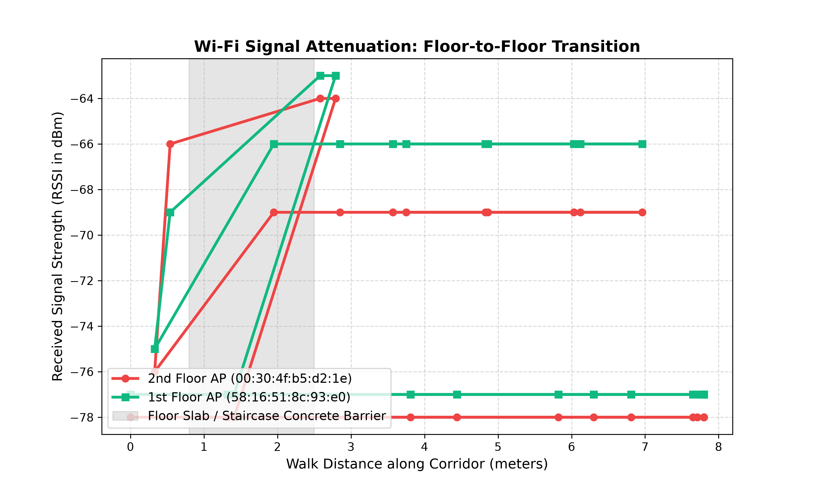
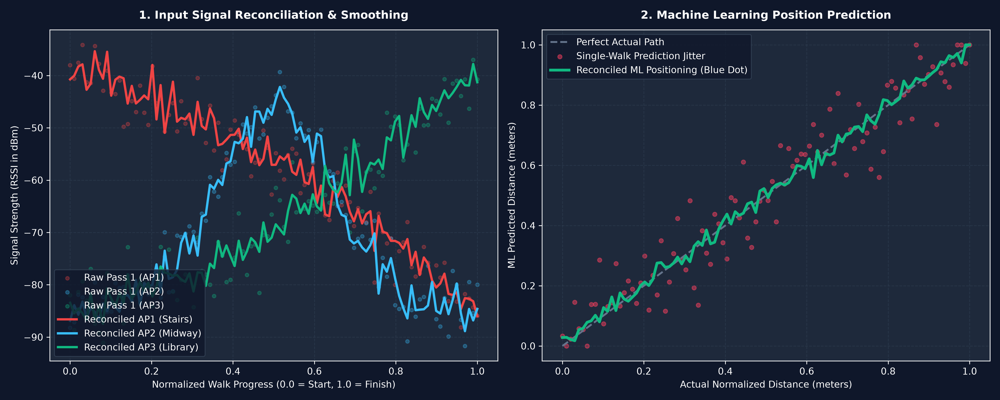
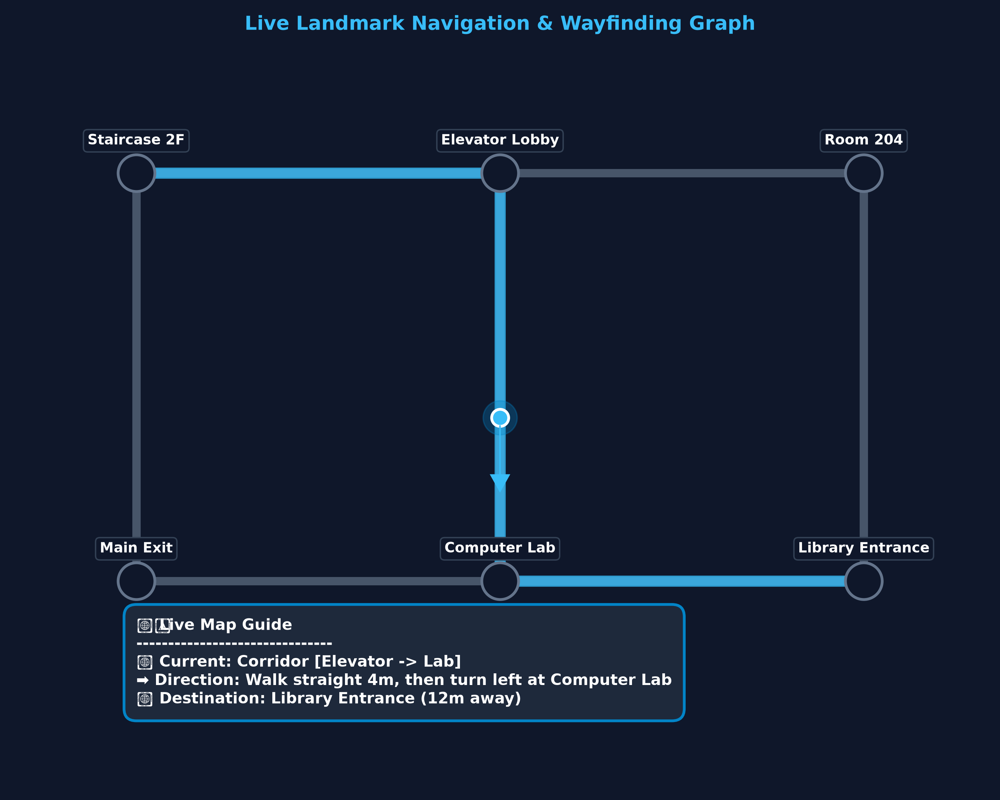

# YourWay — Wi-Fi Indoor Positioning Without Extra Hardware


## About

GPS stops working once you go indoors. Most indoor-positioning products deal with this by installing Bluetooth beacons or selling dedicated survey hardware, and both are expensive to deploy and maintain.

**YourWay** uses the Wi-Fi access points a building already has. A surveyor walks the building with the Android app, which records Wi-Fi signal-strength "fingerprints". A Python machine-learning pipeline then learns to estimate a phone's position from a single live scan.

The project has two parts:
- **Android survey app (Kotlin, Jetpack Compose):** collects Wi-Fi fingerprints. It has a simple *Landmark Mode*: type a start and finish point, walk, and the app tags every scan with how far along the route it was taken. No floor plan needed.
- **Python ML pipeline:** cleans and aligns repeated walks, trains a Random Forest model, and analyses how walls and floor slabs weaken the signal.

I built and tested it on a university campus (University of Johannesburg).

---

## Key Engineering Highlights

- **Map-free Landmark Mode survey (`MainScreen.kt`):** Instead of tapping your position on a blueprint, you walk from a named start landmark to a named finish landmark. Background coroutines scan Wi-Fi every 3.5 s, and each scan's position is set by linear time interpolation (progress from `0.0` to `1.0`).
- **Combining repeated walks (`reconcile_data.py`):** Lines up repeated walks of the same route into 10% progress bins and averages the readings, which reduces noise from people blocking the signal and from reflections.
- **Random Forest localization (`train_model.py`):** Builds a feature matrix from every access point seen (165 unique BSSIDs in the pilot data; an AP that isn't detected is set to -100 dBm) and predicts position. On a held-out split of the 30-point pilot dataset, the mean error was **about 2.2 m**.
- **Finding walls and floors from signal drops (`visualize_barriers.py`):** Measures how fast the signal drops per metre walked. In the real campus data, one access point fell by roughly 25 dBm over about 1.8 m during a floor change (2nd floor → library on the 1st floor), consistent with a concrete floor slab.
- **Pedestrian dead reckoning (map mode):** Counts steps with Android's step detector, checks phone tilt with the accelerometer, and tracks heading from low-pass-filtered compass readings.

---

## Results & Visuals

### 1. Signal drop across a floor change — *real survey data*
Created by `visualize_barriers.py` from `wifi_dataset.json`, which holds real Wi-Fi scans I collected on campus. The plot follows two real access points while I walked from the 2nd floor down to the 1st-floor library:



### 2. Effect of combining walks on prediction — *simulated illustration*
Created by `visualize_ml_mockup.py` from **synthetic** data. It shows the concept behind the pipeline: averaging several noisy walks gives smoother signal curves and steadier position estimates. It is not a measured result.



### 3. Indoor navigation concept — *design mockup*
Created by `plot_map_guide.py`. The landmarks and route are **illustrative placeholders**. The plot shows the planned next step: placing the predicted route progress on a graph of connected landmarks to give turn-by-turn directions.



---

## Current Limitations & Next Steps

- The pilot dataset is small (30 fingerprints from one session). The ~2.2 m figure comes from that dataset, where position labels were estimated by step counting (dead reckoning), not surveyed ground truth.
- Next: collect several walks per route with Landmark Mode, retrain on the combined data, and evaluate on separate walks that weren't used for training.
- Planned: run the model on the phone itself (TensorFlow Lite) to show a live position dot, plus landmark-graph navigation.

---

## Tech Stack

| Layer | Technologies |
| :--- | :--- |
| **Android client** | Kotlin, Jetpack Compose (Material 3), Coroutines, `WifiManager`, `SensorManager` (step detector, accelerometer, magnetometer), SQLite |
| **Data processing** | Python, Pandas, NumPy, JSON export, spatial binning |
| **ML & visualisation** | scikit-learn (`RandomForestRegressor`), joblib, NetworkX, Matplotlib |

---

## Repository Structure

```text
├── app/src/main/java/com/example/wififingerprintsurvey/
│   ├── MainActivity.kt              # Permissions & app entry point
│   ├── Models.kt                    # Wi-Fi scan & survey record models
│   ├── WifiSurveyDbHelper.kt        # SQLite storage & JSON export
│   └── ui/main/MainScreen.kt        # Compose UI: Landmark Mode, Map/PDR Mode, History
├── reconcile_data.py                # Lines up and averages repeated walks
├── train_model.py                   # Feature matrix + Random Forest training/evaluation
├── visualize_barriers.py            # Signal-drop analysis (real data)
├── visualize_ml_mockup.py           # Concept illustration (synthetic data)
├── plot_map_guide.py                # Navigation graph mockup
├── wifi_dataset.json                # Real pilot Wi-Fi fingerprint dataset
└── WifiFingerprintSurvey.apk        # Debug build of the Android app
```

---

## Quick Start

```bash
# Build the Android app (or install WifiFingerprintSurvey.apk directly)
./gradlew assembleDebug

# Combine repeated Landmark Mode walks
python reconcile_data.py

# Train and evaluate the localization model
python train_model.py wifi_dataset.json

# Regenerate the real-data signal plot
python visualize_barriers.py
```
